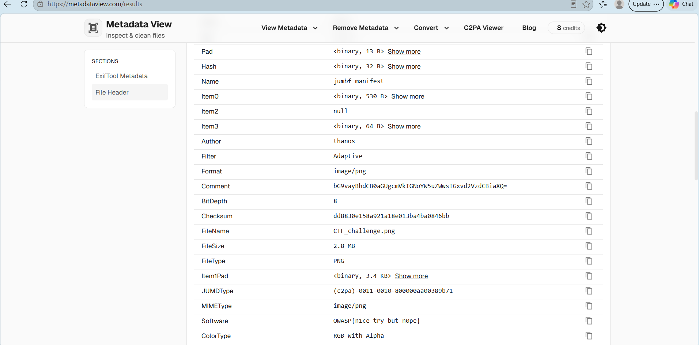
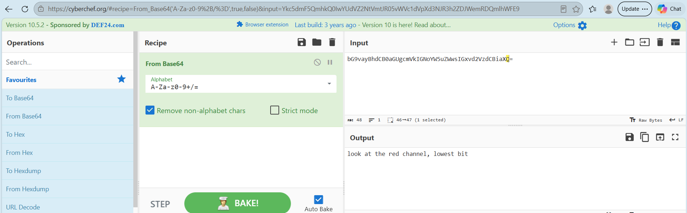
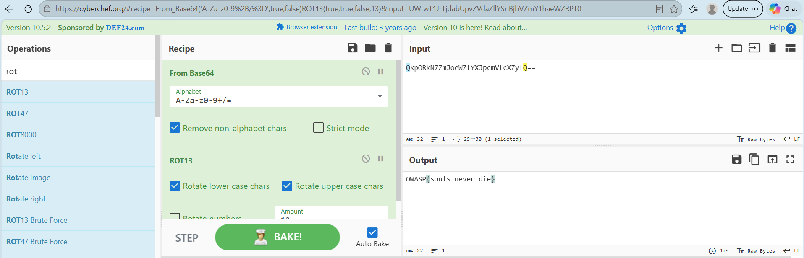
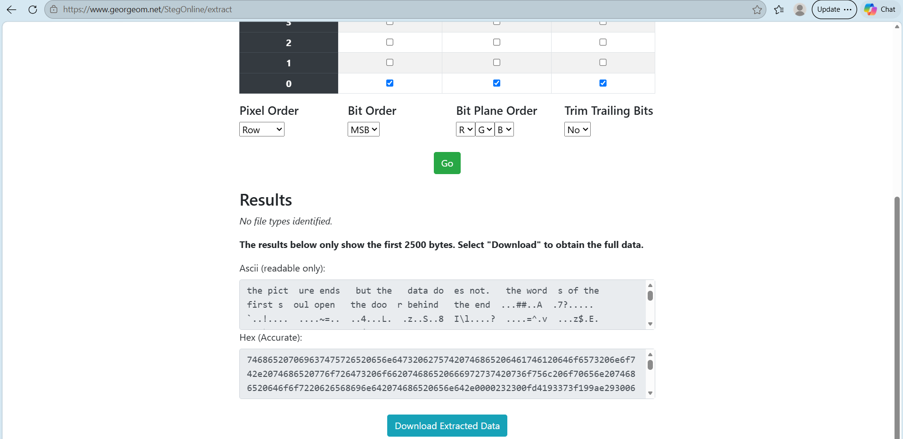
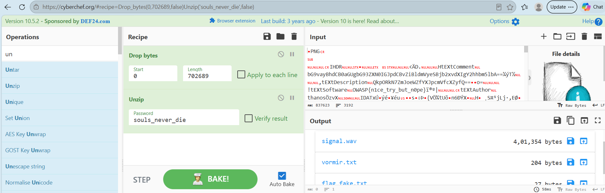
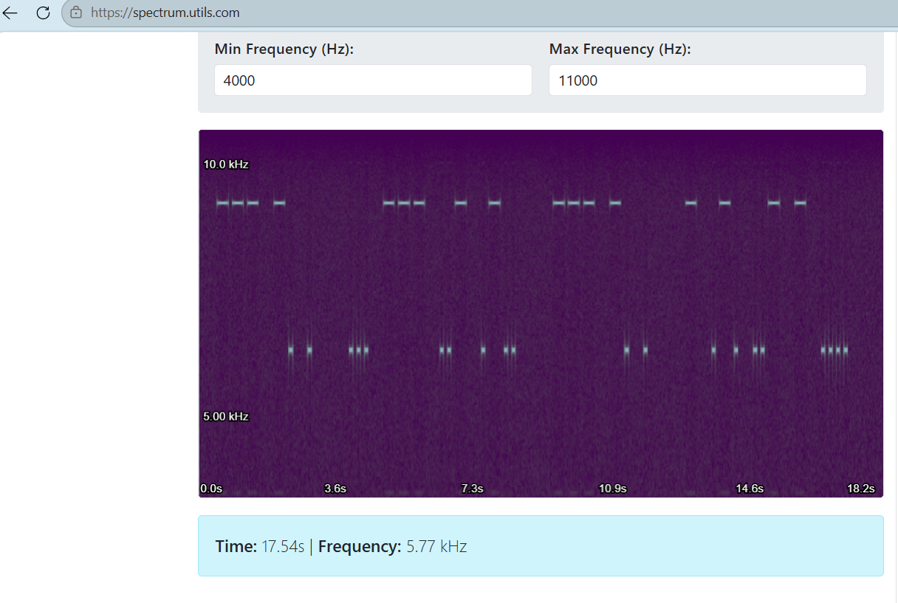
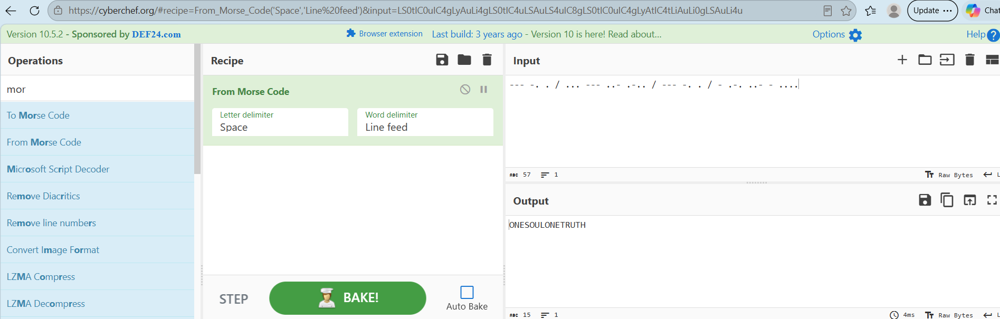
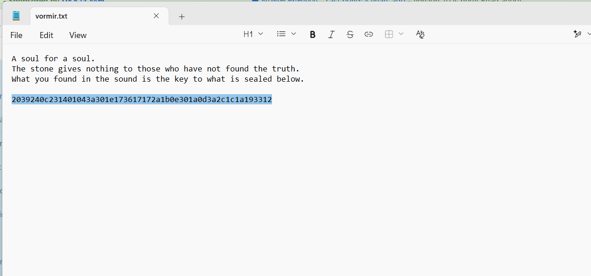
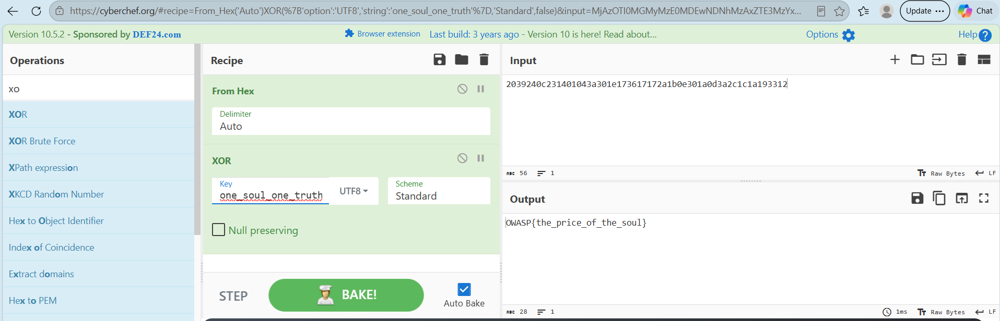

# One Soul, One Truth (Steganography, Medium)

**Author:** AzureCurrent  
**Category:** Steganography  
**Difficulty:** Medium

## Challenge Description

> *A fractured file holds more than one truth. Thanos left pieces of himself scattered across a single image — in its metadata, in its pixels, in what's hidden behind it. Only those who refuse to settle for the first answer will find what the soul stone really costs.*

## Summary

`CTF_challenge.png` is a layered steganography and crypto puzzle. The PNG's metadata holds two base64-encoded hints, one of which is itself a decoy flag. The image's colour-plane bit 0 hides a riddle pointing at a ZIP file appended after the PNG's `IEND` chunk (a PNG/ZIP polyglot). The ZIP, unlocked with a password recovered from the metadata decoy, contains a second decoy flag, a riddle text file, and a `.wav` file whose spectrogram encodes a Morse-code key. That key XOR-decrypts a hex string in the riddle file to produce the real flag. Three decoy flags are seeded along the way specifically to catch players who submit too early.

## Flag

```
OWASP{the_price_of_the_soul}
```

---

## Recon

Uploading `CTF_challenge.png` to [Aperi'Solve](https://www.aperisolve.com) and reviewing its tabs surfaced three leads at once:

- **Strings** showed `OWASP{n1ce_try_but_n0pe}` in the PNG's Software metadata field. This is **Decoy 1** — do not submit it.
- **Zsteg** flagged extra data after the image's `IEND` chunk, meaning a second file is appended behind the picture.
- **Binwalk** identified a ZIP archive inside the file and offered to extract it.

## Step 1 — Read the metadata

Pulling the PNG's text chunks (via `exiftool` or a metadata viewer such as metadataview.com) returned:

| Field | Value |
|---|---|
| Author | `thanos` — theme flavour only |
| Software | `OWASP{n1ce_try_but_n0pe}` — same decoy as in Recon |
| Comment | `bG9vayBhdCB0aGUgcmVkIGNoYW5uZWwsIGxvd2VzdCBiaXQ=` |
| Description | `QkpORkN7ZmJoeWZfYXJpcmVfcXZyfQ==` |



Both the Comment and Description values are base64. Decoding them in [CyberChef](https://gchq.github.io/CyberChef):

**Comment** → From Base64 → *look at the red channel, lowest bit*. This is the hint for Step 2.



**Description** → From Base64 → ROT13 → `OWASP{souls_never_die}`.



`souls_never_die` is **Decoy 2** — do not submit it. Keep it, because it is the password needed in Step 3.

## Step 2 — Follow the bit-plane hint

Using [StegOnline](https://georgeom.net/StegOnline) → **Extract Files/Data**:

1. Upload the PNG.
2. Tick **bit 0** on the Red, Green and Blue planes.
3. Set Pixel Order to `Row`, Bit Order to `MSB`, Bit Plane Order to `R, G, B`, and Trim Trailing Bits to `No`.
4. Click **Go**.



The extracted text reads:

```
the picture ends but the data does not. the words of the first soul open the door behind the end.
```

"The first soul" refers back to the Step 1 decoy, so the ZIP password is `souls_never_die`.

## Step 3 — Open the ZIP

In CyberChef, with `CTF_challenge.png` as the input:

1. Add **Drop bytes**. Set Start to `0` and Length to `702689` — the offset at which binwalk showed the PNG ends and the ZIP begins.
2. Add **Unzip**. Enter the password `souls_never_die`.
3. **Bake**, then save each extracted file from the output pane.



```
signal.wav      401,354 bytes
vormir.txt          204 bytes
flag_fake.txt        27 bytes
```

`flag_fake.txt` contains `OWASP{almost_there_but_no}` — **Decoy 3**.

## Step 4 — Read the audio as a spectrogram

`signal.wav` sounds like faint high-pitched beeps; the payload is visual, not audible.

1. Load the file into an online spectrogram viewer that accepts `.wav` upload (e.g. spectrum.utils.com).
2. Set the frequency range to roughly **4000–11000 Hz** so both rows of marks are visible.
3. Read the two rows of marks: short marks (~6 kHz) are Morse dots, long marks (~9 kHz) are Morse dashes. Wider gaps separate letters and words.



The marks decode to:

```
--- -. . / ... --- ..- .-.. / --- -. . / - .-. ..- - ....
O N E   S O U L   O N E   T R U T H
```

Decoding in CyberChef with **From Morse Code** (letter delimiter `Space`, word delimiter `Forward slash`) confirms it:



The message is `one soul one truth` → `OWASP{one_soul_one_truth}`. This is **Decoy 4** — do not submit it. Keep `one_soul_one_truth` as the decryption key for the final step.

## Step 5 — Decrypt the final file

`vormir.txt` reads: *"the stone gives nothing to those who have not found the truth. what you found in the sound is the key to what is sealed below."*, followed by a hex string.



```
2039240c231401043a301e173617172a1b0e301a0d3a2c1c1a193312
```

In CyberChef:

1. Add **From Hex** (delimiter `Auto`).
2. Add **XOR**. Key: `one_soul_one_truth`, key type `UTF8`, scheme `Standard`.



```
OWASP{the_price_of_the_soul}
```

## Solution Summary

| Field | Value |
|-------|-------|
| Challenge file | `CTF_challenge.png` |
| Decoys | `n1ce_try_but_n0pe`, `souls_never_die`, `almost_there_but_no`, `one_soul_one_truth` |
| ZIP password | `souls_never_die` |
| XOR key | `one_soul_one_truth` |
| Real flag | `OWASP{the_price_of_the_soul}` |

## Root Cause

This is a puzzle, not a live vulnerability, but each layer relies on a real-world weak point that a naive reviewer (or automated scanner) would miss:

- **Shallow metadata/strings review:** `strings` and a quick metadata glance surface a plausible-looking flag (`n1ce_try_but_n0pe`) immediately, encouraging early submission without checking the rest of the file.
- **PNG/ZIP polyglot:** most PNG viewers and parsers stop reading at the `IEND` chunk, so arbitrary data — here, a password-protected ZIP — can be appended and remain invisible unless the file is inspected past its logical end.
- **LSB steganography:** altering only the lowest bit of each colour channel leaves the image visually unchanged, so a hidden message survives casual visual inspection and even some automated diffing.
- **Audio steganography via spectrogram:** encoding data as specific tone frequencies produces audio that sounds like noise but reveals structured text when viewed as a spectrogram — bypassing anyone who only listens rather than visualizes.
- **Chained secrets:** the ZIP password and the XOR key are both decoy-flag strings from earlier steps, so skipping or mis-transcribing an earlier step silently breaks a later one.

## Remediations

Framed as controls against someone using these same techniques for real data exfiltration or malware staging:

- **Inspect past declared file boundaries.** Treat any trailing data after a file's defined end-of-data marker (e.g. PNG `IEND`) as suspicious; tools like binwalk should be part of routine file triage.
- **Scan for LSB/bit-plane anomalies** in images crossing network boundaries, not just visible content — statistical steganalysis (e.g. chi-square tests) catches LSB payloads that look clean to the eye.
- **Don't trust audio content on sound alone.** Automated spectrogram analysis can catch tone-encoded payloads that are inaudible or disguised as noise.
- **Rotate/avoid reusing secrets across contexts.** Chaining the same string as both a flag and a password/key is a readability choice for a CTF, but in production this pattern (reusing a leaked value as a credential elsewhere) is a real and common weakness.
- **Don't rely on strings/metadata alone** for triage — pair quick looks with deeper format-aware parsing to avoid stopping at a planted decoy.

## Tools Used

- [Aperi'Solve](https://www.aperisolve.com) — combined strings/zsteg/binwalk triage
- A PNG metadata viewer (`exiftool` / metadataview.com)
- [CyberChef](https://gchq.github.io/CyberChef) — Base64, ROT13, Drop bytes, Unzip, From Morse Code, From Hex, XOR
- [StegOnline](https://georgeom.net/StegOnline) — bit-plane extraction
- An online spectrogram viewer (spectrum.utils.com)

## Timeline

| Step | Action | Result |
|---|---|---|
| 0 | Upload PNG to Aperi'Solve | Decoy flag in strings; appended ZIP flagged by zsteg/binwalk |
| 1 | Decode Comment and Description metadata (Base64 / Base64+ROT13) | Bit-plane hint + Decoy 2 (`souls_never_die`) |
| 2 | Extract Red/Green/Blue bit 0 via StegOnline | Riddle text pointing at the appended ZIP |
| 3 | Drop bytes(0, 702689) then Unzip with password `souls_never_die` | `signal.wav`, `vormir.txt`, `flag_fake.txt` (Decoy 3) |
| 4 | View `signal.wav` as a spectrogram, decode Morse | Key `one_soul_one_truth` (also Decoy 4 as a flag) |
| 5 | From Hex then XOR with key `one_soul_one_truth` on `vormir.txt`'s hex string | Real flag captured |
