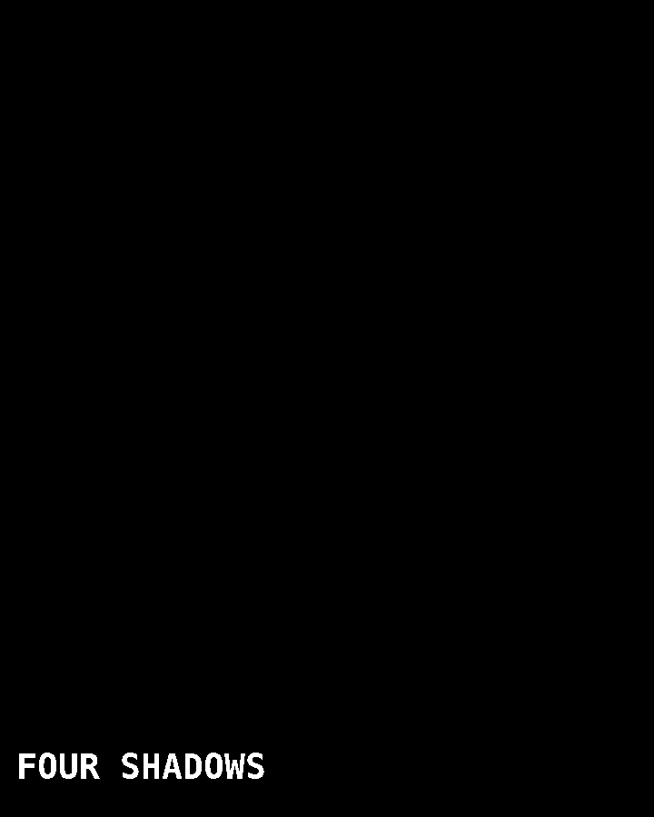
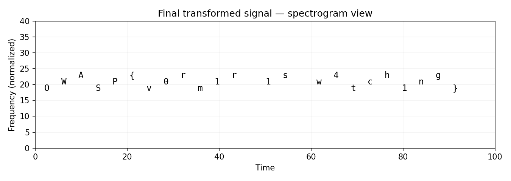

# The Fifth Stone (Steganography, Insane)

**Author:** AzureCurrent  
**Category:** Steganography  
**Difficulty:** Insane

## Challenge Description

> *Everyone looks at the soldier. Nobody asks what is hidden behind the light. Some things survive only when you stop looking at them directly.*

The challenge is a layered steganography and forensics puzzle in which the visible PNG is only the outermost layer.

## Summary

`CTF_insane_v2.png` is a multi-stage steganography, cryptography, network-forensics and audio-analysis challenge. A custom PNG chunk contains a riddle, the alpha channel reveals an intermediate clue, and the RGB least-significant bits contain a scattered encrypted payload. Decryption produces a deliberately damaged PCAP containing several plausible streams. The correct stream reconstructs a stereo WAV whose real message is revealed only after subtracting the two channels, reversing the result, and viewing it as a spectrogram. Several convincing false leads are planted throughout the chain.

## Flag

```
OWASP{v0rm1r_1s_w4tch1ng}
```

---

## Recon

The first step is to stop treating the file as merely an image. A file-type check confirms an RGBA PNG, but ordinary strings and metadata do not expose the final flag. PNG chunk inspection reveals a non-standard ancillary chunk named `mYsT`.

- The visible image is an ordinary 720×900 RGBA PNG.
- The file contains a custom `mYsT` chunk.
- There is no complete `OWASP{...}` flag in the metadata.

The challenge is designed so that shallow scanning produces clues, but not the answer.

## Step 1 — Inspect the PNG chunks

Using `pngcheck`, a hex viewer, or a small PNG chunk parser, inspect the file structure rather than relying only on an image viewer.

```bash
pngcheck -v CTF_insane_v2.png
```

The unusual `mYsT` chunk is the important discovery. Its body is base64-encoded and then zlib-compressed. Decoding those layers gives:

```
FOUR SHADOWS / BLUE BEFORE GREEN / COUNT BACKWARD /
TWO EARS / TURN BACK /
the key is made from what the shadows say and what the ears command.
Do not trust the first readable message.
```

The custom PNG chunk provides clues, but deliberately does not reveal the complete extraction algorithm.

## Step 2 — Extract the alpha-channel clue

The PNG is RGBA, so inspect the alpha channel. Almost every pixel has alpha 255. A small set of pixels has alpha 254 and forms a hidden visual message.



The extracted message is:

```
FOUR SHADOWS
```

This confirms the first phrase from the custom chunk. It is intentionally not the encryption password; it is one ingredient used to derive later parameters.

## Step 3 — Recover the scattered RGB payload

The phrase "BLUE BEFORE GREEN" indicates that the RGB channels matter, while "COUNT BACKWARD" points toward a permutation rather than sequential LSB extraction. The payload is hidden in bit 0 of the colour channels after a Fisher–Yates shuffle driven by xorshift32.

The seed is derived from the clue phrase:

```
SHA256("four shadows|blue before green|count backward")[:4]
```

The three logical channel ranges are ordered as (where `N = width × height`):

| Logical range | Source |
|---|---|
| `0 … N−1` | Blue LSB |
| `N … 2N−1` | Green LSB |
| `2N … 3N−1` | Red LSB |

The permutation is generated with xorshift32 and Fisher–Yates:

```
x ^= (x << 13) & 0xffffffff
x ^= x >> 17
x ^= (x << 5) & 0xffffffff

for j = M-1 ... 1:
    k = next() % (j+1)
    swap(order[j], order[k])
```

Reading the bits at the resulting positions reconstructs a binary payload. Its first 32 bits are a big-endian length field, followed by the encrypted body.

## Step 4 — Derive the encryption key

The custom chunk says that the key is made from what the shadows say and what the ears command. Combining the discovered phrases gives:

```
FOUR SHADOWS|turn back|two ears
```

The encryption key is the SHA-256 digest of that string:

```
key = SHA256("FOUR SHADOWS|turn back|two ears")
```

The payload is XORed with a SHA-256 counter keystream. Each block is:

```
SHA256(key || counter_le32)
```

XORing the ciphertext with the generated keystream produces a damaged PCAP.

## Step 5 — Repair and inspect the PCAP

The decrypted bytes begin with zeros instead of the normal PCAP magic. The challenge intentionally corrupts the PCAP header.

Expected little-endian PCAP magic:

```
d4 c3 b2 a1
```

Restore the first four bytes and repair the snaplen field to `65535`. The resulting file opens as a valid PCAP.

The capture contains several plausible streams. This is deliberate: selecting the first readable stream leads to a dead end.

- Multiple UDP streams are present.
- DNS traffic contains clue-like names.
- A decoy stream can be decompressed but does not contain the intended payload.
- The real stream is **UDP/31337 from 10.13.37.5 to 10.13.37.9**.

The packet sequence field is XOR-masked. The mask is the first two bytes of the derived encryption key:

```
mask = first 16 bits of SHA256("FOUR SHADOWS|turn back|two ears")
real_sequence = encoded_sequence XOR mask
```

Sort by the recovered sequence number and concatenate the payload chunks.

## Step 6 — Recover the WAV

The reconstructed stream is zlib-compressed. Decompressing it produces a stereo WAV file.

```python
wav = zlib.decompress(reconstructed_stream)
```

The audio contains a plausible decoy message if inspected casually. The intended clue is instead "TWO EARS / TURN BACK", which points to the two stereo channels and a reversal operation.

## Step 7 — Transform the audio and inspect its spectrogram

Take the difference between the left and right channels:

```python
difference = Left - Right
```

Then apply the second half of the clue:

```python
difference = difference[::-1]
```

In other words, the intended signal is `reverse(L - R)`.

The result is not intended to be understood by listening. Generate a spectrogram, roughly covering the 500–8000 Hz region. The hidden characters become visible as structured marks.



The spectrogram reveals the final flag.

## Solution Summary

| Field | Value |
|-------|-------|
| Challenge file | `CTF_insane_v2.png` |
| Custom chunk | `mYsT` (base64 + zlib) |
| LSB seed | `SHA256("four shadows\|blue before green\|count backward")[:4]` |
| Key | `SHA256("FOUR SHADOWS\|turn back\|two ears")` |
| Real stream | UDP/31337, 10.13.37.5 → 10.13.37.9 |
| Real flag | `OWASP{v0rm1r_1s_w4tch1ng}` |

## Root Cause

This is a puzzle rather than a live vulnerability, but each layer exploits a real-world assumption that a shallow forensic workflow might make.

- **Format-boundary assumption:** data after a logical file boundary can be ignored by normal viewers.
- **LSB steganography:** modifying only the lowest colour bits can preserve the visible appearance of an image.
- **Metadata over-trust:** readable strings can be planted as decoys and are not proof of the final answer.
- **Protocol ambiguity:** multiple network streams can make a correct payload look like one of many plausible candidates.
- **Audio steganography:** meaningful information can be hidden in channel relationships and frequency-domain representations rather than ordinary listening.
- **Chained derivations:** intermediate clues are required to recover later parameters, preventing a single superficial scan from solving the challenge.

## Remediations

For real-world defensive analysis, the same techniques suggest several controls:

- Inspect complete file boundaries and flag unexpected trailing or custom data.
- Perform format-aware PNG chunk inspection instead of relying only on strings.
- Use statistical and bit-plane steganalysis when image integrity matters.
- Inspect both network metadata and payload structure; do not assume the first interesting stream is the correct one.
- Treat unexplained audio as a possible spectrogram or channel-domain payload and automate spectral inspection when appropriate.
- Avoid reusing discovered strings as credentials or cryptographic keys in real systems.

## Tools Used

- `pngcheck` / hex editor — PNG structure and custom chunk inspection
- CyberChef — Base64, zlib and byte-level transformations
- Python — xorshift32, Fisher–Yates reconstruction, LSB extraction and cryptographic processing
- Wireshark / `tshark` — PCAP stream and packet inspection
- SciPy / Matplotlib — channel transformation and spectrogram generation
- Any standard WAV player/editor — optional audio sanity check

## Timeline

| Step | Action | Result |
|---|---|---|
| 0 | Inspect PNG structure and custom chunks | `mYsT` chunk discovered |
| 1 | Decode `mYsT` (Base64 + zlib) | Four-shadow / RGB / audio clues |
| 2 | Extract alpha != 255 | `FOUR SHADOWS` |
| 3 | Reconstruct xorshift32 + Fisher–Yates LSB order | Encrypted payload recovered |
| 4 | Derive SHA-256 key and XOR keystream | Damaged PCAP recovered |
| 5 | Repair PCAP; identify UDP/31337; unmask sequence numbers | Ordered compressed stream |
| 6 | zlib decompress | Stereo WAV |
| 7 | Reverse(L−R) and inspect spectrogram | Real flag captured |

## Final Result

```
CTF_insane_v2.png
→ custom PNG chunk
→ alpha-channel clue
→ scattered RGB LSB payload
→ SHA-256 counter-stream decryption
→ damaged PCAP
→ packet reordering
→ zlib
→ stereo WAV
→ reverse(L − R)
→ spectrogram
→ OWASP{v0rm1r_1s_w4tch1ng}
```
