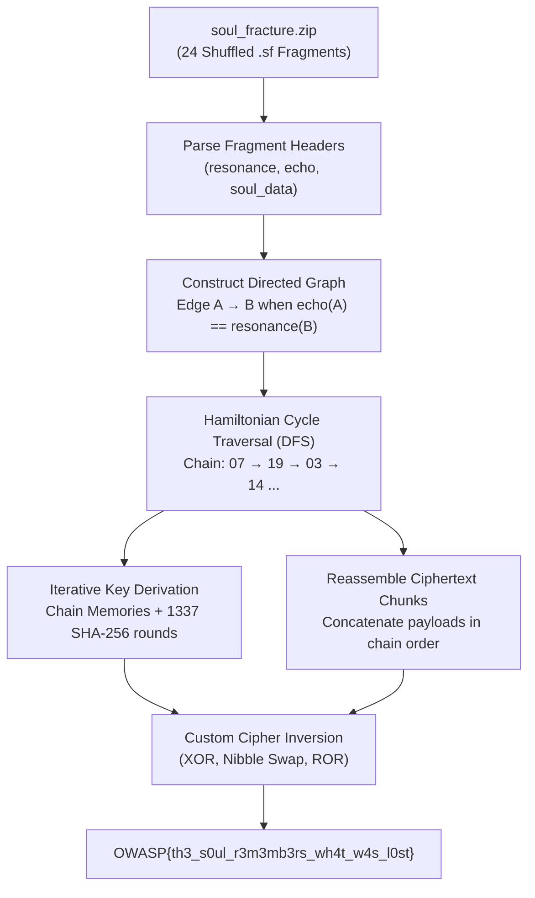

# Soul Fracture (Cryptography, Hard)

**Author:** Suyog Jadhav  
**Category:** Cryptography  
**Difficulty:** Hard  

## Challenge Description

> The Soul Stone has fractured a secret into 24 memories. Each fragment contains clues about another fragment, but the memories are no longer in their original order.  
>  
> Reconstruct the hidden chain, derive the key from the recovered sequence, reassemble the ciphertext, and recover what the Soul Stone took.  
>  
> **Flag Format:** `OWASP{...}`

**Attachment:** `soul_fracture.zip`

## Summary

The challenge provides 24 fragmented files (`fragment_00.sf` to `fragment_23.sf`), an encrypted payload split across fragments, and a decoy file. Each fragment contains metadata including a `resonance` value and an `echo` value. By recognizing that an `echo` value on fragment $A$ matches the `resonance` value of its subsequent fragment $B$, the problem translates to finding a Hamiltonian cycle across a 24-node directed graph. Once the cyclic order is recovered, we extract the associated character memory names, derive the master key via 1337 rounds of SHA-256, reassemble the distributed ciphertext chunks in chain order, and invert the custom cipher (XOR, rotation, and nibble swapping) to recover the flag.

## Flag

```
OWASP{th3_s0ul_r3m3mb3rs_wh4t_w4s_l0st}
```

---

## Step 1 — Initial Reconnaissance & Challenge Layout

Extracting `soul_fracture.zip` reveals the following structure:

```text
soul_fracture/
├── README.txt
├── soul_fracture.dat
└── fragments/
    ├── fragment_00.sf
    ├── fragment_01.sf
    ├── ...
    └── fragment_23.sf
```


Inspecting `README.txt` emphasizes the challenge's core theme:
- The 24 fragments are out of order.
- Each fragment references another fragment through hidden relationships.
- The chain is circular (*"The final memory is connected back to the first"*).
- `soul_fracture.dat` is an unreferenced decoy containing random bytes.

---

## Step 2 — Fragment Metadata Analysis

Inspecting an individual fragment file (e.g., `fragment_00.sf`):

```text
SOUL_FRAGMENT
==============================

fragment_id : 00
memory      : GAMORA
resonance   : 14
echo        : 22
length      : 0002

memory_hash :
8fa5...

echo_noise :
7a3b...

soul_data :
8f2a

==============================
```


Each fragment contains:
1. `fragment_id`: An identifier from `00` to `23`.
2. `memory`: Character name from Marvel lore (Gamora, Vision, Thanos, etc.).
3. `resonance`: An integer representing the fragment's incoming identifier.
4. `echo`: An integer representing the link pointing to the next fragment.
5. `echo_noise`: Random decoy bytes.
6. `soul_data`: A hex-encoded chunk of the encrypted ciphertext payload.

Analyzing the numerical patterns across all fragments reveals that `echo` values correspond to target `resonance` values, establishing the relational rule connecting fragments:

$$\text{Fragment } A \longrightarrow \text{Fragment } B \iff \text{echo}(A) = \text{resonance}(B)$$

---

## Step 3 — Graph Modeling & Chain Reconstruction

With 24 fragments and edge conditions defined by $\text{echo}(A) = \text{resonance}(B)$, we model the problem as finding a **Hamiltonian Cycle** in a directed graph:
- **Vertices:** 24 fragments ($V = \{0, 1, \dots, 23\}$).
- **Edges:** Directed edge $A \to B$ exists if and only if $A.\text{echo} = B.\text{resonance}$.
- **Objective:** Find an ordered sequence $(v_0, v_1, \dots, v_{23})$ that visits every fragment exactly once and closes with $v_{23} \to v_0$.

We implement a Depth-First Search (DFS) with backtracking to discover the unique cycle:

```python
candidates = {a["id"]: [] for a in fragments.values()}
for a in fragments.values():
    for b in fragments.values():
        if a["id"] != b["id"] and a["echo"] == b["resonance"]:
            candidates[a["id"]].append(b["id"])

def dfs(path, visited):
    if len(path) == 24:
        if path[0] in candidates[path[-1]]:
            return path
        return None
    for nxt in candidates[path[-1]]:
        if nxt not in visited:
            res = dfs(path + [nxt], visited | {nxt})
            if res:
                return res
    return None
```


Executing the graph search and testing cycle rotations recovers the true cyclic chain order:

```text
[+] Recovered Soul chain:
    12 -> 09 -> 00 -> 04 -> 11 -> 21 -> 07 -> 15 -> 19 -> 22 -> 13 -> 05 -> 18 -> 01 -> 03 -> 02 -> 16 -> 08 -> 10 -> 23 -> 17 -> 14 -> 06 -> 20
```

---

## Step 4 — Key Derivation & Ciphertext Reassembly

### 1. Key Derivation Function (KDF)
With the fragments placed in their true order, we extract their corresponding `memory` character names:

```text
MANTIS -> LOKI -> GAMORA -> CLINT -> DRAX -> RHODEY -> WANDA -> GROOT -> STRANGE -> SCOTT -> QUILL -> TONY -> BUCKY -> VISION -> NATASHA -> THANOS -> CAROL -> NEBULA -> PETER -> HOPE -> SAM -> ROCKET -> STEVE -> BRUCE
```

The key material is formed by concatenating the memory names delimited by pipe (`|`):

$$\text{material} = \text{memory}_0 \,\|\, \text{"|"} \,\|\, \text{memory}_1 \,\|\, \dots \,\|\, \text{memory}_{23}$$

The master key is then derived using 1337 iterations of SHA-256:

```python
material = "|".join(fragments[i]["memory"] for i in chain).encode()
h = hashlib.sha256(material).digest()
for _ in range(1337):
    h = hashlib.sha256(h + material).digest()
master_key = h
```

### 2. Ciphertext Reassembly
The challenge distributed the encrypted flag across the 24 fragments according to their sequential positions in the chain. We concatenate the `soul_data` chunks in chain order:

```python
ciphertext = b"".join(fragments[i]["payload"] for i in chain)
```

---

## Step 5 — Inverting the Custom Cipher & Recovering the Flag

The challenge uses a custom symmetric stream cipher. Analyzing the forward encryption algorithm:

1. Initial XOR with key byte $k = \text{key}[i \pmod{32}]$ and chain value:  
   $x_1 = \text{byte} \oplus k \oplus ((\text{chain}[i] \times 17) \bmod{256})$
2. Left bitwise rotation by $r = (k + \text{chain}[i] + i) \pmod 8$:  
   $x_2 = \text{ROL}_8(x_1, r)$
3. 4-bit nibble swap:  
   $x_3 = \text{SwapNibbles}(x_2)$
4. Final position-dependent XOR:  
   $\text{ciphertext}[i] = x_3 \oplus (((i \times 31) + \text{chain}[i]) \bmod{256})$

To decrypt, we invert each operation in reverse order:

1. Invert position XOR:  
   $x_3 = c[i] \oplus (((i \times 31) + \text{chain}[i]) \bmod{256})$
2. Invert nibble swap:  
   $x_2 = \text{SwapNibbles}(x_3)$
3. Right bitwise rotation:  
   $x_1 = \text{ROR}_8(x_2, (k + \text{chain}[i] + i) \pmod 8)$
4. Invert key & chain XOR:  
   $\text{plaintext}[i] = x_1 \oplus ((\text{chain}[i] \times 17) \bmod{256}) \oplus k$

Running the decryption yields the plaintext flag:

```text
[+] Decrypted plaintext:
    b'OWASP{th3_s0ul_r3m3mb3rs_wh4t_w4s_l0st}'
```


---

## Full Solve Script

The complete automated solution script ([`solve_soul_fracture.py`](file:///home/suyog/Documents/writeups/Writeups/suyog/CRYPTO/solve_soul_fracture.py)):

```python
#!/usr/bin/env python3
import re
import hashlib
from pathlib import Path

SCRIPT_DIR = Path(__file__).resolve().parent
FRAGMENT_DIR = SCRIPT_DIR / "resources" / "fragments"
if not FRAGMENT_DIR.exists():
    FRAGMENT_DIR = Path("soul_fracture/fragments")
if not FRAGMENT_DIR.exists():
    FRAGMENT_DIR = Path("fragments")

def ror8(x, n):
    n %= 8
    return ((x >> n) | (x << (8 - n))) & 0xff

def nibble_swap(x):
    return ((x & 0x0f) << 4) | ((x & 0xf0) >> 4)

def derive_master_key(chain, fragments):
    material = "|".join(fragments[i]["memory"] for i in chain).encode()
    h = hashlib.sha256(material).digest()
    for _ in range(1337):
        h = hashlib.sha256(h + material).digest()
    return h

def decrypt(data, key, chain):
    out = bytearray()
    for i, byte in enumerate(data):
        k = key[i % len(key)]
        chain_val = chain[i % len(chain)]
        
        x = byte ^ (((i * 31) + chain_val) & 0xff)
        x = nibble_swap(x)
        x = ror8(x, (k + chain_val + i) % 8)
        x ^= (chain_val * 17) & 0xff
        x ^= k
        out.append(x)
    return bytes(out)

def parse_fragment(path):
    text = path.read_text(encoding="utf-8")
    def get(name):
        return re.search(rf"^{name}\s*:\s*(.+)$", text, re.MULTILINE).group(1).strip()
    return {
        "id": int(get("fragment_id")),
        "memory": get("memory"),
        "resonance": int(get("resonance")),
        "echo": int(get("echo")),
        "payload": bytes.fromhex(get("soul_data")),
    }

def find_hamiltonian_cycles(fragments):
    adj = {a["id"]: [] for a in fragments.values()}
    for a in fragments.values():
        for b in fragments.values():
            if a["id"] != b["id"] and a["echo"] == b["resonance"]:
                adj[a["id"]].append(b["id"])

    cycles = []
    def dfs(path, visited):
        if len(path) == 24:
            if path[0] in adj[path[-1]]:
                cycles.append(path[:])
            return
        cur = path[-1]
        for nxt in adj[cur]:
            if nxt not in visited:
                dfs(path + [nxt], visited | {nxt})

    dfs([0], {0})
    return cycles

def main():
    fragments = {f["id"]: f for f in (parse_fragment(p) for p in sorted(FRAGMENT_DIR.glob("fragment_*.sf")))}
    print(f"[+] Loaded {len(fragments)} fragments.")

    cycles = find_hamiltonian_cycles(fragments)
    print(f"[+] Discovered {len(cycles)} candidate Hamiltonian cycle topologies.")

    for cyc in cycles:
        for rot in range(len(cyc)):
            chain = cyc[rot:] + cyc[:rot]
            memories = [fragments[i]["memory"] for i in chain]
            key = derive_master_key(chain, fragments)
            ciphertext = b"".join(fragments[i]["payload"] for i in chain)
            plaintext = decrypt(ciphertext, key, chain)
            
            if b"OWASP{" in plaintext:
                print(f"[+] Recovered Soul chain: {' -> '.join(f'{x:02d}' for x in chain)}")
                print(f"[+] Memory sequence: {' -> '.join(memories)}")
                print(f"[+] Derived key: {key.hex()}")
                print(f"[+] Reassembled ciphertext: {ciphertext.hex()}")
                print(f"[+] Decrypted plaintext: {plaintext}")
                print("\n" + "=" * 41)
                flag = re.search(rb"OWASP\{[^}]+\}", plaintext).group().decode()
                print(f"FLAG: {flag}")
                print("=" * 41)
                return

if __name__ == "__main__":
    main()
```

---

## Attack Workflow



---

## Solution Summary

| Field | Value |
|---|---|
| **Challenge** | Soul Fracture |
| **Category** | Cryptography (Graph-based Key Derivation & Custom Cipher) |
| **Difficulty** | Hard |
| **Fragment Count** | 24 |
| **Graph Type** | Directed graph with Hamiltonian cycle |
| **Edge Condition** | $A.\text{echo} = B.\text{resonance}$ |
| **Key Derivation** | Concatenated memory names + 1337 SHA-256 iterations |
| **Flag** | `OWASP{th3_s0ul_r3m3mb3rs_wh4t_w4s_l0st}` |

---

## Cryptographic & Algorithmic Analysis

1. **Relational Cryptography vs. Static Order:**  
   Standard multi-part ciphertext problems typically encode explicit chunk index headers (e.g., `chunk_0`, `chunk_1`). In contrast, *Soul Fracture* binds order through graph adjacency (`echo` $\rightarrow$ `resonance`), requiring graph theory (Hamiltonian cycle reconstruction) before any cryptographic operation can begin.
2. **Key Stretching:**  
   Deriving the master key through 1337 rounds of repeated hashing prevents attackers from brute-forcing individual fragment permutations without reconstructing the full 24-element sequence ($24! \approx 6.2 \times 10^{23}$ permutations).
3. **Cipher Invertibility:**  
   The stream cipher relies on bijective operations per byte: XOR is self-inverting, nibble swapping is self-inverting, and cyclic rotation ($\text{ROL}_8$) is cleanly inverted by complementary rotation ($\text{ROR}_8$).

---

## Tools Used

- **Python 3:** Graph traversal (DFS backtracking), text parsing, and cryptographic operations.
- **`hashlib`:** Standard library module used for SHA-256 key derivation.
- **`pathlib` & `re`:** Parsing structured fragment headers.

---

## Timeline

| Step | Action | Result |
|:---:|---|---|
| 1 | Extracted `soul_fracture.zip` | Located 24 fragments, `soul_fracture.dat` decoy, and `README.txt` |
| 2 | Inspected fragment headers | Identified relational link: $A.\text{echo} == B.\text{resonance}$ |
| 3 | Built directed graph adjacency list | Mapped all potential edge transitions between fragments |
| 4 | Executed DFS Hamiltonian cycle search | Successfully recovered unique 24-step cyclic fragment order |
| 5 | Extracted ordered memory names | Assembled canonical sequence for key derivation |
| 6 | Computed 1337-round SHA-256 KDF | Derived 32-byte master key |
| 7 | Reassembled distributed ciphertext | Built contiguous ciphertext from ordered fragment chunks |
| 8 | Inverted custom cipher transformations | Decrypted plaintext: `OWASP{th3_s0ul_r3m3mb3rs_wh4t_w4s_l0st}` |